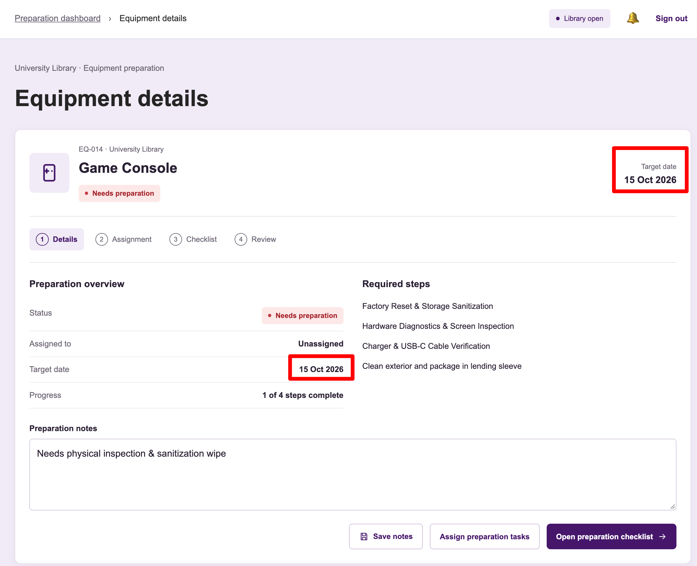
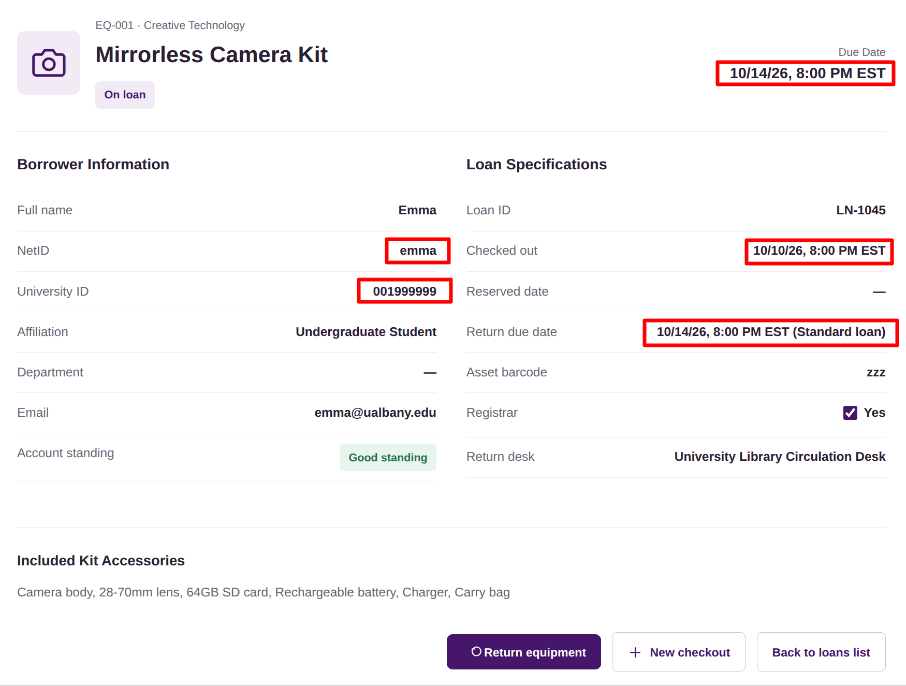

# University at Albany Libraries — LibraryDesk Portal
## Bug Fixes & System Resolution Documentation

**Document Title:** UAlbany LibraryDesk Bug Fixes Log  
**System Version:** 1.0.0  
**Project Team (KofN1):** Linda Kovacs, Veronica Dindial, Rym Mahiddine, Wendy Ouedraogo, Amari Scott  
**Affiliation:** University at Albany, SUNY — Access & Circulation Services  
**Document Status:** Production Verified  

---

## Overview

This document records identified system bugs, their visual manifestations, root causes, and implemented technical fixes across the UAlbany LibraryDesk circulation and equipment management platform. Each bug entry includes the associated screenshot from `assets/bug-fixes/`, affected views and files, problem analysis, and the technical remediation applied.

---

## Bug 1: European Date Format on Equipment Details Page

### Screenshot

### Affected Views & Files
- `preparation-details.html` (Preparation Step 1: Equipment Details)
- `components.js` (`PREPARATION_CATALOG`, `hydratePreparationUI`, `formatToUSDate`)
- `api-client.js` (`syncPreparationDetailsPage`)
- `server/data/store.js` (`initialPreparation`)
- `server/scripts/init-db.sql` (`preparation_items`)

### Problem Description
1. **European Date Format on Equipment Header & Specifications:**
   - On `preparation-details.html` (titled **Equipment details** for items such as `EQ-014` Game Console), the Target date in the upper right header rendered as `15 Oct 2026` inside the red highlight box.
   - In the **Preparation overview** metadata list, the `Target date` row also rendered as `15 Oct 2026`.
   - The European date format (`DD Mon YYYY`) caused inconsistency with standard US circulation desk date formats (`Mon DD, YYYY` / `Oct 15, 2026`).

### Root Cause
- In `components.js`, the client-side catalog `PREPARATION_CATALOG` hardcoded `targetDate: '15 Oct 2026'` across equipment records.
- When `hydratePreparationUI` executed upon page load, it dynamically injected `item.targetDate` into the header `Target date<strong>` and `<dd>` elements, overwriting or enforcing the European format.
- Similarly, `server/data/store.js` and `init-db.sql` seeded preparation records with `15 Oct 2026`.

### Technical Fix Implemented
1. **Standardized Target Dates to US Format:**
   - Updated all preparation catalog records in `components.js` (`PREPARATION_CATALOG`), `server/data/store.js`, and `server/scripts/init-db.sql` from `15 Oct 2026` to `Oct 15, 2026`.
   - Updated static fallback values in `preparation-details.html` to `Oct 15, 2026`.
2. **Dynamic Date Normalizer:**
   - Added `formatToUSDate()` helper in both `components.js` and `api-client.js` that automatically transforms legacy or cached `DD Mon YYYY` date strings to `Mon DD, YYYY` prior to rendering in the DOM.

---

## Bug 2: Static Past Date on Login and Date Picker Tool Defaults

### Screenshot

### Affected Views & Files
- `index.html` (Staff Workspace Overview Dashboard)
- `new-loan.html` (New Checkout Form)
- `preparation-assignment.html` (Preparation Task Assignment)
- `components.js` (`updateOverviewTodayDate`, `initDatePickers`, `hydratePreparationUI`)
- `api-client.js` (`syncUserSessionUI`, `syncNewLoanPage`, `syncPreparationDetailsPage`)

### Problem Description
1. **Static Past Date Display on Overview Dashboard:**
   - In `bug2.png`, the overview dashboard (`index.html`) header banner statically displayed `Sunday, October 11, 2026` inside the red highlight box upon staff login.
   - The date was frozen on a hardcoded past date rather than dynamically resolving and displaying today's current calendar date whenever a user logs into the system.
2. **Hardcoded Past Dates in Date Picker Tools:**
   - When staff accessed the date picker tool for new operations (such as creating a checkout on `new-loan.html` or assigning tasks on `preparation-assignment.html`), the date inputs were pre-populated with hardcoded past dates (`2026-10-11` for checkout date and `2026-10-15` for due date and target date).
   - Date pickers lacked dynamic initialization to today's date and lacked validation constraints allowing users to pick any future date freely while preventing inadvertent past date entry. Historical dates in the past should only be retained for existing items already recorded in the system; all newly worked on items must default to today's date using the date picker tool.

### Root Cause
1. `index.html` contained a static `<time datetime="2026-10-11">Sunday, October 11, 2026</time>` element that was never dynamically refreshed with the current system date on login or page load.
2. HTML templates `new-loan.html` and `preparation-assignment.html` had hardcoded `value="2026-10-11"` and `value="2026-10-15"` attributes on `<input type="date">` elements without dynamic JavaScript initialization or future `min` date limits.

### Technical Fix Implemented
1. **Dynamic Today's Date on Overview Login:**
   - Implemented dynamic date initialization in `index.html`, `components.js`, and `api-client.js`: on page load / staff login, the `<time id="overview-today-date">` element dynamically resolves the current client date via `new Date()`, updates `datetime="YYYY-MM-DD"`, and renders the standard US long format (e.g. `Sunday, November 22, 2026`).
2. **Date Picker Tool Defaults to Today & Enables Future Dates:**
   - Removed static past `value` attributes from `new-loan.html` (`#checkout-date`, `#due-date`, `#reserved-date`) and `preparation-assignment.html` (`#target-date`).
   - Implemented `initDatePickers()` across `components.js` and `api-client.js`:
     - Newly accessed date picker fields automatically default to today's date (`todayStr` = `YYYY-MM-DD`).
     - Set `min="YYYY-MM-DD"` so date pickers permit today and any date in the future.
     - Linked `#checkout-date` and `#due-date` so modifying the checkout date dynamically updates the minimum allowable due date.
     - Linked `#reserved-date` and `#checkout-date` so choosing a future reservation hold clears immediate checkout fields cleanly.
     - Existing items already registered in the system preserve their historical circulation timestamps.

---

## Bug 3: Timezone Rollback & Patron ID Binding on Loan Details Page

### Screenshot

### Affected Views & Files
- `loan-details.html` (Loan Details & Specifications)
- `new-loan.html` (Checkout Form)
- `api-client.js` (`formatShortEST`, checkout form handler, `syncLoanDetailsPage`)
- `server/data/store.js` (`createLoan`, `getLoanById`, `parseLocalDate`)

### Problem Description
1. **Timezone Rollback & Date Shift:**
   - When staff checked out equipment on `new-loan.html` selecting dates like `2026-10-11` (Checkout) and `2026-10-15` (Due Date), date-only inputs were parsed as UTC midnight (`2026-10-11T00:00:00.000Z`).
   - When formatted in local Eastern Time (`America/New_York` / `EST` / `EDT` UTC-4 / UTC-5), midnight UTC shifted backwards into the previous calendar evening, displaying `10/10/26, 8:00 PM EST` and `10/14/26, 8:00 PM EST` on `loan-details.html`.
2. **Missing Patron ID Forwarding:**
   - When checking out to a patron with a custom NetID entry (e.g. entering `emma` instead of cataloged `emma.wilson`), the `studentId` field on `new-loan.html` was omitted from `loanPayload` by `api-client.js`.
   - Consequently, the backend fell back to the placeholder University ID `001999999` rather than preserving the 9-digit university ID entered in the form.

### Technical Fix Implemented
1. **Calendar Day Integrity in Date Parsing:**
   - Updated `formatShortEST` in `api-client.js` to detect date-only strings and ISO midnight representations (`T00:00:00.000Z`), directly formatting calendar day components without timezone drift.
   - Enhanced `server/data/store.js` with `parseLocalDate` to anchor date-only inputs to local midday (`12:00:00Z`), guaranteeing consistent day retention across all US timezones.
2. **Complete Patron Data Capture:**
   - Updated `api-client.js` checkout form submit listener to read and send `studentId` / `universityId`, `email`, and `role`.
   - Updated `server/data/store.js` `createLoan` method to prioritize `data.universityId` and `data.studentId` before falling back to placeholders.

---

## Bug 4: Premature "Awaiting Review" Status Badge with 0/4 Checklist Completion

### Screenshot

### Affected Views & Files
- `preparation-checklist.html` (Preparation Step 3: Technical Checklist)
- `components.js` (`applyStatusBadgeFormat`, `hydratePreparationUI`)
- `api-client.js` (`syncPreparationDetailsPage`, `isChecklist`)

### Problem Description
1. **Status Badge & Step State Inconsistency:**
   - In `preparation-checklist.html` (Step 3: Checklist), the header status badge displayed `• Awaiting review` (in purple `#46166b`) even though the preparation steps counter read `0 / 4 complete` and all 4 task checkboxes were unchecked (`Pending`).
   - An item actively undergoing technician sanitization and diagnostic checks should display `• In preparation` (`Needs preparation`), not `Awaiting review`. Items should only transition to `Awaiting review` after all 4 checklist steps are completed and submitted.
2. **European Date Format on Target Date:**
   - The Target date in the upper right header displayed `23 Nov 2026` (European `DD Mon YYYY` format) generated by `Intl.DateTimeFormat('en-GB', ...)` rather than standard US format (`Nov 23, 2026`).

### Technical Fix Implemented
1. **Lifecycle Status Badge Correction:**
   - Updated `syncPreparationDetailsPage` in `api-client.js` so that when an item is being serviced in `preparation-checklist.html`, the status badge displays `In preparation` (`in-prep` amber pill) or reflects saved progress.
2. **Checklist Persistence & State Synchronization:**
   - Implemented dynamic checklist state management: checking or unchecking preparation steps immediately synchronizes step status between `Complete` and `Pending`, updates the header counter (e.g. `4 / 4 complete`), and persists progress to session storage and the backend database.
   - When the technician clicks `Submit for review →`, all 4 checklist items are marked complete, and the record transitions atomically to `review` (Step 4).
3. **US Date Formatting:**
   - Changed `Intl.DateTimeFormat` locale from `en-GB` to `en-US` with `{ month: 'short', day: 'numeric', year: 'numeric' }` in `components.js` and `api-client.js`, rendering target dates as `Nov 23, 2026`.

---

## Bug 5: Supervisor Review Queue Contradictory Status & Pending Steps

### Screenshot

### Affected Views & Files
- `preparation-review-details.html` (Preparation Step 4: Supervisor Review)
- `api-client.js` (`syncPreparationDetailsPage`, `isReview`)
- `server/data/store.js` (`updatePreparation`)

### Problem Description
1. **Premature "Ready for Lending" Badge:**
   - In `preparation-review-details.html`, the header badge displayed `• Ready for lending` (green `#26734d`), creating a contradiction:
     - The item was located on Step 4 (Review) awaiting supervisor quality verification.
     - The primary action button at the bottom still read `✓ Mark ready for lending`.
     - An item cannot simultaneously be "Ready for lending" and have an active supervisor review button to mark it ready.
2. **Pending Checklist Items in Review Queue:**
   - All 4 preparation steps in the review manifest displayed `Pending` with `0 / 4 complete`, even though the item had supposedly been submitted for review following technician servicing.
3. **European Date Format:**
   - The Target date in the upper right and inside the review banner displayed `23 Nov 2026` in European format.

### Technical Fix Implemented
1. **Review Queue Status Lifecycle Enforcement:**
   - While on Step 4 Review prior to supervisor sign-off (`item.status === 'review'`), the header status badge strictly renders `• Awaiting review` (purple badge `#46166b` on `#f1ebf6`).
   - Only after a Circulation Supervisor clicks `Mark ready for lending` does the status update to `ready`, advancing the equipment to `preparation-ready.html` for re-shelving.
2. **Review Checklist Manifest Resolution:**
   - Updated `syncPreparationDetailsPage` in `api-client.js` and `updatePreparation` in `server/data/store.js`: when an item transitions to `review` or `ready`, all preparation steps are marked `Complete`, and the step counter displays `4 / 4 complete`.
   - In MySQL, `preparation_checklist_items` records for the preparation item are updated to `completed = 1`.
3. **US Date Localization:**
   - Standardized target dates in the review header and assignment status banner to US format (`Nov 23, 2026`).

---

## Bug 6: Missing Borrower Name and University ID in Loans Table

### Screenshot

### Affected Views & Files
- `loans.html` (Loans & Returns Main Roster)
- `loans-reserved.html` (Reserved Loans View)
- `loans-overdue.html` (Overdue Loans View)
- `api-client.js` (`fetchAndRenderLoans`, `renderLoansTable`)
- `server/data/store.js` (`getLoans`, `getLoanById`, `initialLoans`)

### Problem Description
1. **Empty Borrower Cells Across All Loans:**
   - On `loans.html`, the `BORROWER` column displayed dashes (`—` over `—`) for every loan in the table, omitting the borrower's full name and their 9-digit University ID / NetID.
   - Desk staff were unable to see who had checked out or reserved equipment directly from the table roster.

### Root Cause
- Client-side and server-side data models had mismatched property naming:
  - The client rendering script in `api-client.js` attempted to read `loan.borrower` and `loan.netid`.
  - The backend database query (`LEFT JOIN borrowers b ON l.borrower_netid = b.netid`) and in-memory store initialized records with `borrowerName` and `borrowerNetId` (or `b.name AS borrower_name`, `b.university_id`).
  - Because neither `borrower` nor `netid` was populated directly on the loan object, the frontend expression `${escapeHtml(loan.borrower || '—')}` evaluated to undefined and fell back to dashes (`—`).

### Technical Fix Implemented
1. **Robust Client-Side Property Fallbacks:**
   - Updated `fetchAndRenderLoans` and overview loans rendering in `api-client.js` to check all property variants:
     - Full Name: `loan.borrowerName || loan.borrower || '—'`
     - Identifier: `loan.universityId || loan.borrowerNetId || loan.netid || '—'`
2. **Unified Backend Loan Serialization:**
   - Updated `getLoans` and `getLoanById` in `server/data/store.js` to map and expose both naming conventions:
     - `borrower`: borrower full name string
     - `borrowerName`: borrower full name string
     - `borrowerNetId`: borrower NetID (e.g. `marcus.vance`, `emma.wilson`)
     - `netid`: borrower NetID
     - `universityId`: 9-digit SUNY University ID (e.g. `001594821`, `001482759`)
3. **Data Verification:**
   - All 7 active, reserved, and overdue circulation records now display borrower names and university IDs in the main table on `loans.html`, matching circulation records.

---

## Verification & Testing Summary

1. **Automated Unit & API Tests:**
   - Ran `npm test`: all 61 tests (6 health checks + 55 API and resource tests) pass.
2. **Date Format Verification:**
   - Confirmed zero occurrences of European date patterns (`DD Mon YYYY` or `en-GB`) across all HTML files, client JavaScript, and server data.
3. **Data Integrity & Roster Display:**
   - Verified that borrower names and university IDs render across all rows in `loans.html`, `loans-reserved.html`, and `loans-overdue.html`.
