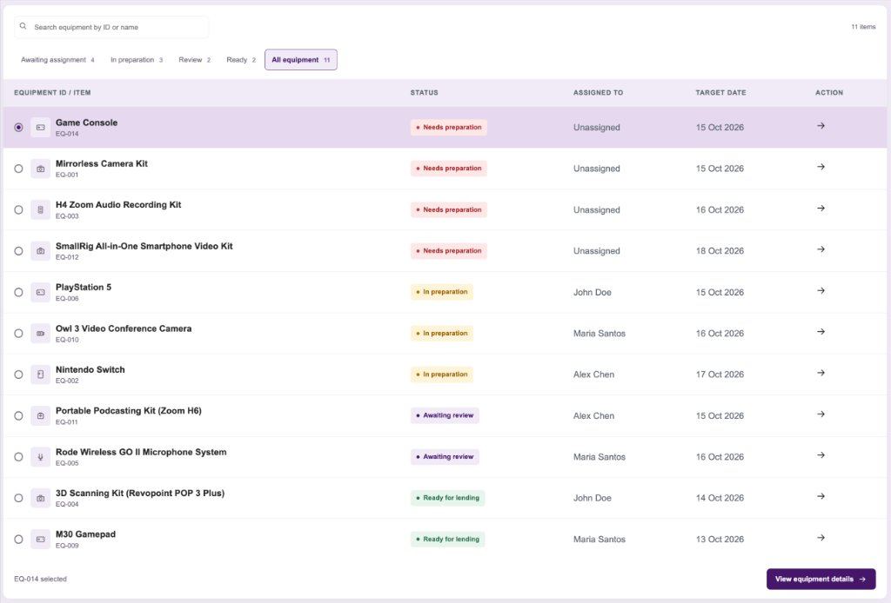
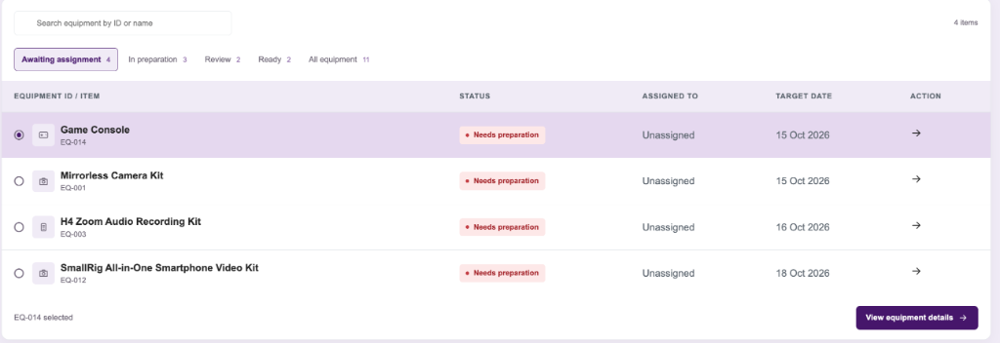
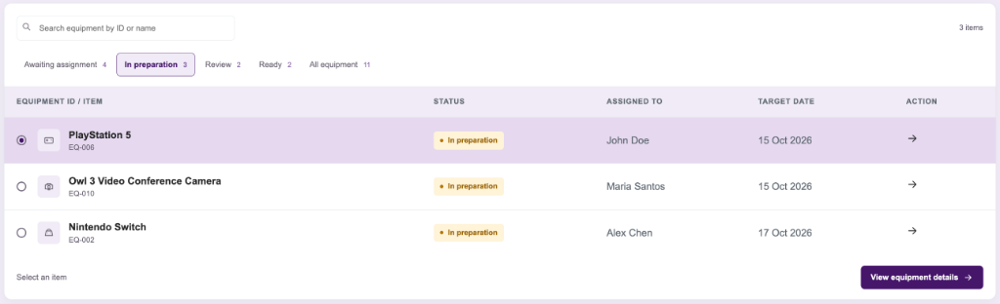
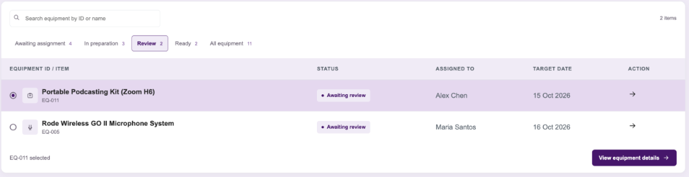
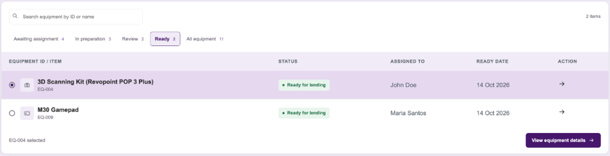

# University at Albany Libraries — LibraryDesk Portal
## Equipment & Resource Management System (ERMS)
### Comprehensive Step-by-Step User Manual & Operational Reference Guide

---

**Document Title:** UAlbany LibraryDesk End-User Operations Manual  
**Target Audience:** Library Circulation Specialists, Student Staff Assistants, Desk Supervisors, and Departmental Stakeholders  
**System Version:** 1.0.0  
**Project Team (KofN1):** Linda Kovacs, Veronica Dindial, Rym Mahiddine, Wendy Ouedraogo, Amari Scott  
**Affiliation:** University at Albany, SUNY — Access & Circulation Services  
**Document Status:** Final / Production-Ready  

---

## Table of Contents

1. [Executive Overview & Purpose](#1-executive-overview--purpose)
2. [Access Instructions & System Requirements](#2-access-instructions--system-requirements)
3. [User Roles, Permissions & Authentication](#3-user-roles-permissions--authentication)
4. [Global Interface Navigation & Layout](#4-global-interface-navigation--layout)
5. [Standard Operating Procedure 1: Dashboard & Circulation Overview](#5-sop-1-dashboard--circulation-overview)
6. [Standard Operating Procedure 2: Equipment Catalog & Availability Search](#6-sop-2-equipment-catalog--availability-search)
7. [Standard Operating Procedure 3: Checking Out Equipment (New Loan)](#7-sop-3-checking-out-equipment-new-loan)
8. [Standard Operating Procedure 4: Managing Active & Overdue Loans](#8-sop-4-managing-active--overdue-loans)
9. [Standard Operating Procedure 5: Processing Equipment Returns](#9-sop-5-processing-equipment-returns)
10. [Standard Operating Procedure 6: Equipment Preparation & Inspection Pipeline](#10-sop-6-equipment-preparation--inspection-pipeline)
11. [Standard Operating Procedure 7: Borrower Directory & Patron Lookup](#11-sop-7-borrower-directory--patron-lookup)
12. [Standard Operating Procedure 8: Circulation Reports & Analytics](#12-sop-8-circulation-reports--analytics)
13. [Standard Operating Procedure 9: Notifications & Alert Center](#13-sop-9-notifications--alert-center)
14. [Architecture: Dynamic Population with Offline Fallback](#14-architecture-dynamic-population-with-offline-fallback)
15. [Known System Limitations & Operational Boundaries](#15-known-system-limitations--operational-boundaries)
16. [Troubleshooting FAQ & Emergency Support Directory](#16-troubleshooting-faq--emergency-support-directory)

---

## 1. Executive Overview & Purpose

The **UAlbany LibraryDesk Portal** is a web-based circulation and equipment lifecycle management platform designed specifically for the University at Albany Libraries. It provides front-desk circulation staff and laboratory supervisors with a unified, real-time interface to manage high-value academic technologies, including laptops, mirrorless camera kits, gaming consoles, audio recorders, 3D scanning equipment, and mobile accessories.

### Key Operational Goals
- **Circulation Control:** Prevent double-booking or overselling through atomic database inventory reservations.
- **Equipment Readiness Assurance:** Enforce a strict 4-stage preparation pipeline (Assignment &rarr; Inspection/Wipe &rarr; Supervisor Review &rarr; Ready for Lending) before returned items are re-shelved.
- **Auditing & Reporting:** Provide real-time dashboards and semester-based utilization analytics.
- **Offline Resilience:** Maintain uninterrupted desk operations even during temporary network or database outages via progressive enhancement and cached fallbacks.

---

## 2. Access Instructions & System Requirements

### 2.1 Web Application URLs
- **Local Workstation Access:** Open any modern browser and navigate to:  
  `http://localhost:3000/` (or `http://localhost:3000/login.html`)
- **Cloud/Hosted Production Access:**  
  `https://ualbany-librarydesk.onrender.com/` (or your institution's designated portal domain)

### 2.2 Workstation Hardware & Hardware Compatibility
| Component | Minimum Specification | Recommended Specification |
|---|---|---|
| **Display Resolution** | 1280 &times; 720 (HD) | 1920 &times; 1080 (Full HD) or dual-monitor desk station |
| **Input Devices** | Standard keyboard & mouse | Keyboard, mouse, and USB HID barcode scanner |
| **Memory (RAM)** | 4 GB | 8 GB+ |
| **Operating System** | macOS 12+, Windows 10/11, Ubuntu 20.04+ | Any OS running a modern evergreen browser |

### 2.3 Supported Web Browsers
The application utilizes modern Web Components, CSS Grid, and the PJAX navigation protocol. The following browsers are officially supported:
- **Google Chrome** (v100+) — *Recommended for Circulation Desk Terminals*
- **Microsoft Edge** (v100+)
- **Mozilla Firefox** (v100+)
- **Apple Safari** (v15+)

> [!NOTE]
> Internet Explorer is **not supported**. JavaScript must be enabled in browser settings.

---

## 3. User Roles, Permissions & Authentication

### 3.1 Security Roles
Access to circulation tools is governed by institutional role-based permissions:

```text
┌────────────────────────────────────────────────────────────────────────┐
│                        UAlbany Staff Roles                             │
├──────────────────────────┬─────────────────────────────┬───────────────┤
│ Role                     │ Typical Staff               │ Core Rights   │
├──────────────────────────┼─────────────────────────────┼───────────────┤
│ Circulation Specialist   │ Student staff, Desk clerks  │ Checkouts,    │
│                          │                             │ Returns,      │
│                          │                             │ Prep tasks    │
├──────────────────────────┼─────────────────────────────┼───────────────┤
│ Lead Technician          │ Senior student staff, Techs │ Checklists,   │
│                          │                             │ Sanitization  │
├──────────────────────────┼─────────────────────────────┼───────────────┤
│ Circulation Supervisor   │ Full-time librarians, Admins│ Final signoff,│
│                          │                             │ Inventory,    │
│                          │                             │ Reports       │
└──────────────────────────┴─────────────────────────────┴───────────────┘
```

### 3.2 Staff Sign-In Procedure

1. Launch your browser and navigate to the **Sign In** screen (`/login.html`).
2. Enter your assigned University at Albany **NetID** and **Password**.
3. Click the **Sign in** button.
4. Upon successful validation:
   - A cryptographic JSON Web Token (JWT) is generated and stored locally in browser session storage.
   - You will be automatically redirected to the **Circulation Dashboard** (`/index.html`).

> 📷 **[Screenshot Placeholder: Staff Sign-In Page]**  
> *Capture: `login.html` showing the NetID input field, Password input field, University Libraries seal, and "Sign in" button.*

#### Training / Default Test Credentials
For workstation evaluation and staff onboarding, the following verified profile is pre-configured:
- **Staff NetID:** `linda.kovacs`
- **Default Password:** `password123`
- **Authorized Role:** Circulation Specialist
- **Assigned Workstation:** Uptown Circulation Desk #2 (`DESK-CIRC-02`)

> [!IMPORTANT]
> Always sign out via the **Staff Profile** (`/profile.html`) when stepping away from the circulation desk to ensure student patron records and checkout logs remain protected.

---

## 4. Global Interface Navigation & Layout

The interface features an intuitive, unified 3-part layout designed for rapid one-click navigation without full-page browser reloads:

```text
┌──────────────────────────────────────────────────────────────────────────────┐
│  [Logo] UAlbany LibraryDesk   [Search Bar...]    (Open) [User: Linda K. ▾]   │  <- App Header
├───────────────┬──────────────────────────────────────────────────────────────┤
│ Overview      │                                                              │
│ Equipment     │                                                              │
│ Loans         │                      MAIN WORKSPACE                          │
│ Borrowers     │          (Tables, Forms, Pipelines, Reports)                 │
│ Preparation   │                                                              │
│ Reports       │                                                              │
│ Notifications │                                                              │
├───────────────┴──────────────────────────────────────────────────────────────┤
│  © 2026 University at Albany Libraries · Circulation Desk Support · v1.0.0    │  <- App Footer
└──────────────────────────────────────────────────────────────────────────────┘
```

### 4.1 Persistent Top Header
- **Breadcrumbs:** Shows your exact path (e.g. `Home > Preparation > Awaiting Assignment`) allowing rapid 1-click back-navigation.
- **Global Search:** Allows direct keyword queries across inventory items, patron records, and loan numbers.
- **Library Operating Status Pill:** Displays `Library Open` (green dot) or `Library Closed` (red dot). Staff can click to inspect operating hours.
- **Staff User Badge:** Displays the active staff initials and workstation station identifier.

### 4.2 Left Navigation Sidebar
- **Overview:** Dashboard KPIs, quick actions, and loan summaries.
- **Equipment:** Live catalog, category filters, and availability stock levels.
- **Loans:** Active loans, overdue tracking, and return processing.
- **Borrowers:** Registered patron directory, NetID search, and standing status.
- **Preparation:** The 4-stage equipment inspection and sanitization pipeline.
- **Reports:** Usage trends, timeframe analytics, and circulation metrics.
- **Notifications:** Alerts for overdue loans, flagged items, and pending reviews.

---

## 5. SOP 1: Dashboard & Circulation Overview

**File:** `index.html`  
**When to Use:** Daily shift start, ongoing monitoring of desk throughput, and quick access to frequent circulation tasks.

> 📷 **[Screenshot Placeholder: Dashboard Overview]**  
> *Capture: `index.html` displaying the top metric cards (Active Loans, Due Today, Overdue, Preparation Queue), Quick Action buttons, and Recent Activity feed.*

### Step-by-Step Instructions:
1. Click **Overview** in the sidebar.
2. Review the top KPI summary cards:
   - **Active Loans:** Total equipment currently in patron possession.
   - **Due Today:** Items expected before desk closing.
   - **Overdue Loans:** Loans past their due date requiring immediate escalation.
   - **Preparation Queue:** Items awaiting sanitization or supervisor review.
3. Use the **Quick Actions** panel on the right side for fast-track tasks:
   - Click **+ New Loan** to open the checkout form.
   - Click **Check-in Return** to process a returned item.
   - Click **Preparation Queue** to inspect staging items.

---

## 6. SOP 2: Equipment Catalog & Availability Search

**File:** `equipment.html`  
**When to Use:** Assisting patrons seeking specific technology, verifying item quantities, or checking maintenance status.

> 📷 **[Screenshot Placeholder: Equipment Catalog]**  
> *Capture: `equipment.html` displaying the category filter dropdown, live search input, and table of equipment items with stock pills.*

### Step-by-Step Instructions:
1. Click **Equipment** in the navigation sidebar.
2. Filter the catalog using either method:
   - **Search Field:** Type any equipment name (e.g. *Switch*, *Zoom*, *Camera*) or ID (e.g. *EQ-001*). The table dynamically updates with debounced live search.
   - **Category Dropdown:** Select *All Categories*, *Creative Technology*, *Gaming*, *AV Equipment*, or *Laptops*.
3. Read the **Availability** column:
   - **Green Badge ("Available"):** Stock is on shelves ready for immediate loan.
   - **Yellow/Amber Badge ("Low Stock"):** 1 unit remaining.
   - **Red Badge ("Out of Stock"):** All units currently checked out.
   - **Gray Badge ("Maintenance"):** Item temporarily held for repairs or battery replacement.
4. Click the arrow (**&rarr;**) on any row to open the full equipment detail view.

---

## 7. SOP 3: Checking Out Equipment (New Loan)

**File:** `new-loan.html`  
**When to Use:** Checking out hardware to a registered student, faculty member, or researcher.

> 📷 **[Screenshot Placeholder: New Loan Checkout Form]**  
> *Capture: `new-loan.html` showing the Borrower NetID field with patron preview card, Equipment Item select box, Loan Period radio buttons, and "Complete Checkout" button.*

### Step-by-Step Instructions:

```text
  ┌─────────────────────────────────────────────────────────────┐
  │ 1. Enter Borrower NetID ────► Patron Status Verified        │
  │                                     │                       │
  │ 2. Select Equipment Item ───► Stock Checked Atomically       │
  │                                     │                       │
  │ 3. Choose Loan Duration ────► Due Date Calculated           │
  │                                     │                       │
  │ 4. Click "Complete Checkout"► DB Decrements & Loan Created  │
  └─────────────────────────────────────────────────────────────┘
```

1. Click **New Loan** in the sidebar or click **+ New Loan** from the dashboard.
2. In the **Borrower NetID** field, enter the patron's NetID (e.g. `emma.wilson`) or scan their UAlbany ID card barcode.
   - *Verification:* The patron's full name, department, standing, and active loan count will immediately preview on screen.
   - *Warning Check:* If the patron has overdue items or holds, an alert banner will notify staff.
3. In the **Equipment Item** dropdown, select the requested item (e.g. `EQ-001 - Mirrorless Camera Kit`).
   - The system displays the currently available shelf stock. Items with 0 stock cannot be selected.
4. Select the **Loan Duration**:
   - `3 Days` (Standard high-demand kits)
   - `7 Days` (Standard course equipment)
   - `14 Days` (Special research loans)
   - `Semester` (Faculty/Staff long-term reservation)
   The system automatically computes the exact **Due Date & Time**.
5. Ensure the patron agrees to the UAlbany Equipment Lending Policy terms.
6. Click **Complete Checkout**.
   - The system executes an atomic transaction in MySQL: the equipment quantity decrements by 1, the patron's active loans increment by 1, and an active loan record is generated.
   - You are redirected to `loans.html` where the new loan record immediately appears at the top.

---

## 8. SOP 4: Managing Active & Overdue Loans

**Files:** `loans.html`, `loans-overdue.html`, `loan-details.html`  
**When to Use:** Tracking outstanding loans, answering patron inquiries, and managing delinquent returns.

> 📷 **[Screenshot Placeholder: Active Loans Table]**  
> *Capture: `loans.html` displaying the All Loans / Overdue tabs, search bar, borrower name column, due date column, and status badges.*

### Step-by-Step Instructions:
1. Click **Loans** in the sidebar.
2. Toggle between queue tabs:
   - **All Loans:** Lists every active, unreturned equipment item.
   - **Overdue (`loans-overdue.html`):** Filters strictly for loans past their due date.
3. Multi-Field Search:
   - Type a borrower name (e.g. *Emma*), NetID (*alex.chen*), loan number (*LN-1042*), or item name (*Nintendo*).
   - The table live-filters dynamically.
4. Inspecting Loan Details:
   - Click any loan row to open `loan-details.html?id=LN-XXXX`.
   - View checkout timestamp, staff member who authorized the checkout, item serial number, and borrower email.
5. Overdue Protocol:
   - For items in the Overdue tab, click **Send Reminder** to dispatch an automated notification to the patron's university email address.

---

## 9. SOP 5: Processing Equipment Returns

**File:** `return-item.html`  
**When to Use:** When a borrower returns borrowed technology to the circulation desk.

> 📷 **[Screenshot Placeholder: Return Check-in Screen]**  
> *Capture: `return-item.html` showing the Loan ID lookup input, Equipment Condition selector, Destination Routing checkboxes, and "Process Return" button.*

### Step-by-Step Instructions:
1. Click **Loans &rarr; Return Item** or click **Check-in Return** from the Dashboard.
2. In the **Loan ID / Equipment Barcode** field, enter or scan the identifier (e.g. `LN-1042` or `EQ-001`).
3. Verify the retrieved loan details on screen:
   - Confirm borrower identity.
   - Confirm returned item matches original checkout serial number.
4. Perform physical check:
   - Check all accessories against the case checklist (cables, lens caps, chargers, SD cards).
5. Select **Physical Condition**:
   - `Good Condition — No damage`
   - `Minor Wear — Operational`
   - `Needs Sanitization / Data Wipe`
   - `Damaged / Missing Parts`
6. Select **Destination Routing**:
   - **Immediate Return to Shelves:** For standard items ready for immediate re-loan (increments stock instantly).
   - **Route to Preparation Queue (Recommended for AV/Electronics):** Sends item to staging queue for data wiping, battery recharging, and supervisor review before re-shelving.
7. Click **Process Return**:
   - The loan record transitions to `returned`.
   - The patron's active loan count decrements.
   - A success banner confirms completion.

---

## 10. SOP 6: Equipment Preparation & Inspection Pipeline

**Files:** `preparation.html`, `preparation-assignment.html`, `preparation-checklist.html`, `preparation-review.html`, `preparation-ready.html`  
**When to Use:** Daily technical preparation, sanitization, data wiping, and supervisor signoff.

### 10.1 Pipeline Lifecycle Overview
Returned high-tech equipment passes through four quality gates before returning to the circulation catalog:

```text
┌────────────────────┐     ┌────────────────────┐     ┌────────────────────┐     ┌────────────────────┐
│ 1. Awaiting Assign │ ──► │ 2. In Preparation  │ ──► │ 3. Awaiting Review │ ──► │ 4. Ready for Lend  │
│ (Needs assignment) │     │ (Sanitize & Wipe)  │     │ (Supervisor check) │     │ (Returned to Shelf)│
└────────────────────┘     └────────────────────┘     └────────────────────┘     └────────────────────┘
```

---

### 10.2 Queue Tab 1: All Equipment (Master Queue)
Displays all items currently undergoing any phase of preparation:



*Key Features Visible Above:*
- Dynamic tab counts (*Awaiting assignment: 4, In preparation: 3, Review: 2, Ready: 2, All equipment: 11*).
- Color-coded status pills: Coral (`Needs preparation`), Amber (`In preparation`), Purple (`Awaiting review`), Green (`Ready for lending`).
- Radio selector for selecting an item to inspect.

---

### 10.3 Queue Tab 2: Awaiting Assignment
Items returned from circulation awaiting task delegation:



#### Procedure to Assign Staff:
1. Select the radio button next to the desired item (e.g. `EQ-014 - Game Console`).
2. Click **View equipment details &rarr;** to open `preparation-assignment.html`.
3. In the assignment modal:
   - Select the **Assigned Staff Member** (e.g. `John Doe`, `Maria Santos`, `Alex Chen`).
   - Set the **Target Completion Date**.
   - Add special inspection instructions (e.g. *"Check HDMI cable and factory reset console"*).
4. Click **Assign Task**. The item immediately moves to the **In Preparation** tab.

---

### 10.4 Queue Tab 3: In Preparation (Sanitization & Inspection)
Items currently assigned to staff undergoing technical checks:



#### Procedure to Complete Technical Checklist:
1. Select the item and click **View equipment details &rarr;** to open `preparation-checklist.html`.
2. Work through the digital checklist:
   - [x] Physical cleaning & sanitization of casing and buttons
   - [x] Storage media data wipe (factory reset SD cards, internal storage)
   - [x] Battery diagnostic (recharged to 100%)
   - [x] Cable & accessory bag verification
   - [x] Firmware check & operational test
3. Add any staff notes regarding cosmetic wear or replaced batteries.
4. Click **Submit for Supervisor Review**. The item status transitions to `awaiting-review` and moves to the Review tab.

---

### 10.5 Queue Tab 4: Supervisor Review
Items awaiting final verification and supervisor quality approval:



#### Procedure for Supervisor Approval:
1. A designated supervisor opens the **Review** tab (indicated by the distinctive **Purple badge** `#46166b` on `#f1ebf6`).
2. Select the item (e.g. `EQ-011 - Portable Podcasting Kit`) and click **View equipment details &rarr;**.
3. Review the completed checklist items and staff notes.
4. Click **Approve & Mark Ready for Lending**.
   - The item status updates to `ready`.
   - The item moves to the **Ready** queue.

---

### 10.6 Queue Tab 5: Ready for Lending (Re-shelving)
Items fully certified, inspected, and ready to be placed on library shelves:



#### Procedure to Re-shelve:
1. Physical items are placed in their designated storage lockers or behind-the-desk bins.
2. Click **Return to Circulation Shelves**.
3. The catalog available quantity increments by 1, making the kit immediately available for new patron checkouts on `equipment.html` and `new-loan.html`.

---

## 11. SOP 7: Borrower Directory & Patron Lookup

**File:** `borrowers.html`  
**When to Use:** Verifying student registration, checking active loan counts, and reviewing borrowing privileges.

> 📷 **[Screenshot Placeholder: Borrower Accounts Table]**  
> *Capture: `borrowers.html` showing the Patron search bar, Department filter, active loan badges, and borrower standing.*

### Step-by-Step Instructions:
1. Click **Borrowers** in the left sidebar.
2. In the search bar, type the patron's name (e.g. *Emma*, *Marcus*, *Sophia*), NetID (`emma.wilson`), or academic department (*Computer Science*, *Art & Art History*).
3. Review the patron card or table row:
   - **Standing:** `Good Standing` (green) or `Suspended / Overdue Hold` (red).
   - **Active Loans:** Indicates how many equipment kits the student currently holds.
   - **University ID:** 9-digit official UAlbany ID number.
4. Click on any borrower to inspect their full borrowing history and past checkout logs.

---

## 12. SOP 8: Circulation Reports & Analytics

**File:** `reports.html`  
**When to Use:** Preparing monthly circulation summaries, equipment utilization reviews, and semester audits.

> 📷 **[Screenshot Placeholder: Reports & Analytics Screen]**  
> *Capture: `reports.html` showing Semester dropdown selector, Date Range inputs, Run Report button, and Equipment Utilization Table with % metrics.*

### Step-by-Step Instructions:
1. Click **Reports** in the navigation sidebar.
2. Configure report parameters:
   - **Semester Selector:** Choose *Summer 2026*, *Fall 2026*, *Spring 2026*, or *Full Academic Year*.
   - **Date Range:** Select specific *From* and *To* calendar dates.
   - **Search Filter:** Filter reporting records by equipment category or item title.
3. Click the purple **Run report** button.
4. Analyze the generated metrics:
   - **Total Circulation Count:** Aggregate checkouts during the selected window.
   - **Average Turnaround Time:** Days between checkout and return check-in.
   - **Utilization Rate (%):** Frequency of checkout vs. idle shelf time.
   - **Maintenance Incidents:** Number of returns flagged for repair.
5. Click **Export CSV** to download a spreadsheet copy for department stakeholders.

---

## 13. SOP 9: Notifications & Alert Center

**File:** `notifications.html`  
**When to Use:** Daily morning triage to review automated alerts.

> 📷 **[Screenshot Placeholder: Notification Center]**  
> *Capture: `notifications.html` displaying categorized alert cards: Overdue Warnings, Maintenance Flagged, and Supervisor Review Reminders.*

### Step-by-Step Instructions:
1. Click **Notifications** in the sidebar.
2. Review alerts categorized by priority:
   - 🔴 **High Priority:** Loans 3+ days overdue requiring phone outreach or bursar hold.
   - 🟡 **Medium Priority:** Loans due before today's 10:00 PM closing.
   - 🟣 **Review Alerts:** Equipment waiting in supervisor review queue for >24 hours.
3. Click the action button on any notification card to jump directly to the relevant loan record or equipment task.

---

## 14. Architecture: Dynamic Population with Offline Fallback

The UAlbany LibraryDesk Portal is engineered with a **dual-layer progressive enhancement architecture** to guarantee continuous circulation desk uptime:

### 14.1 Online Mode (Standard Operation)
When the Express API and MySQL database are active:
- Web pages dynamically fetch live data from REST endpoints (`/api/equipment`, `/api/loans`, `/api/preparation`, `/api/reports`) via `api-client.js`.
- The live database records replace the initial template placeholders seamlessly.
- All checkout, return, assignment, and checklist updates are saved directly to the database with full ACID transaction safety.

### 14.2 Offline Fallback Mode (Resilience Mode)
If the MySQL database or local server experiences network disruptions, power events, or scheduled maintenance:
- The system gracefully catches API network errors without displaying blank pages or crashing.
- Pre-rendered static table structures and cached placeholder records remain visible so staff can continue referencing equipment specs, standard policies, and inspection steps.
- Form submissions display an informative, user-friendly notification: *"Database currently in offline standby. Changes cannot be saved until connectivity is restored."*

---

## 15. Known System Limitations & Operational Boundaries

The following operational constraints are designed into the current system release:

1. **Single Workstation Session per Browser Profile:**  
   Signing into a new staff NetID in the same browser window replaces the previous staff session across all open tabs. To operate multiple desks on one computer, use separate browser profiles (or an Incognito/Private window).
2. **7-Day Session Expiration:**  
   Authentication tokens automatically expire after 7 consecutive days of inactivity. When expired, the system will prompt staff to re-authenticate with their NetID and password.
3. **Checkout Write Protection During Outages:**  
   While read operations gracefully degrade to offline placeholders, creating new loans and finalizing return transactions require a live database connection to prevent inventory count desynchronization.
4. **Barcode Reader Format:**  
   Barcode scanners must be configured in **USB HID Keyboard Wedge Mode** (standard factory default for Zebra, Honeywell, and Symbol scanners). Serial emulation requires keyboard wedge software.
5. **High-Demand Single Unit Concurrency:**  
   If two staff members attempt to checkout the exact last available kit simultaneously, the database transaction lock permits the first request and returns a friendly `"Item out of stock"` notification to the second desk.

---

## 16. Troubleshooting FAQ & Emergency Support Directory

### Frequently Asked Questions

#### Q1: "The login screen displays 'Invalid NetID or Password'."
- **Resolution:** Verify that Caps Lock is disabled. Ensure you are entering your standard university NetID (e.g. `linda.kovacs`, not your full email). If forgotten, contact the ITS Help Desk for password reset.

#### Q2: "An equipment kit shows 0 available stock, but the physical kit is sitting on the shelf."
- **Resolution:** The item is likely still in the **Preparation Queue**. Check `preparation.html`. Once a technician completes the checklist and a supervisor approves it, the item will immediately register as Available.

#### Q3: "The preparation tabs are showing static numbers."
- **Resolution:** Check that your local Node.js server is running (`npm start`) and connected to MySQL. The numbers update automatically when the backend API is live.

#### Q4: "A barcode scan is not auto-submitting the form."
- **Resolution:** Configure your barcode scanner to append a trailing `Enter` / `Carriage Return (CR)` character after each scan in the scanner's programming barcode booklet.

---

### Emergency Desk Support Contacts

| Office / Unit | Location | Phone / Extension | Hours |
|---|---|---|---|
| **Circulation Desk Supervisor** | University Library, 1st Floor | (518) 442-3569 | Mon–Fri: 8:00 AM – 5:00 PM |
| **Library Systems Office** | LI-B28 | (518) 442-3600 | Mon–Fri: 8:30 AM – 4:30 PM |
| **UAlbany ITS Help Desk** | LC-27 | (518) 442-3700 | 24/7 Telephone Support |
| **University Police (Emergency)** | UPD Building | (518) 442-3131 | 24/7 Dispatch |

---

*End of User Documentation — University at Albany Libraries Access & Circulation Services (2026)*
